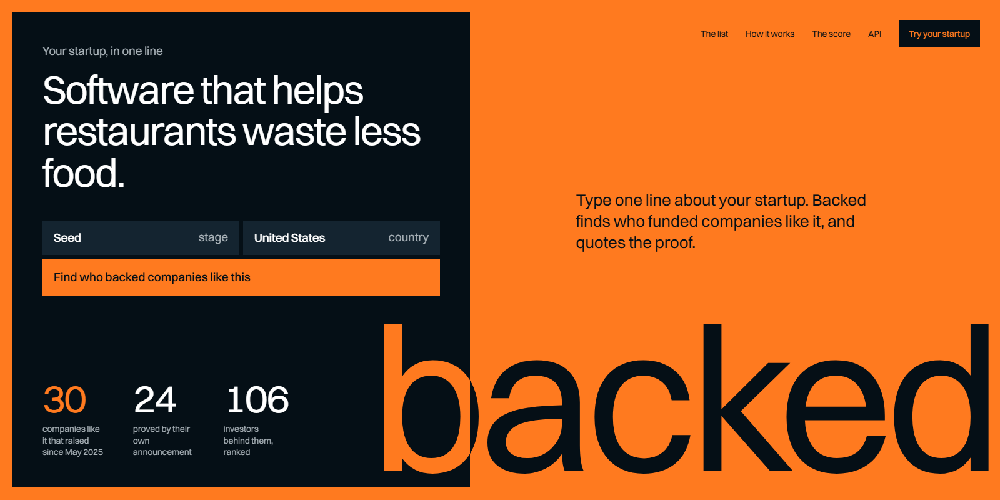

# Backed



Backed answers the question every founder asks: who would actually fund me? You type one line about your startup, with a stage and a country. It finds companies like yours that raised in the last 18 months, reads each one's own funding announcement, and ranks the investors behind them. Every match is proved by a sentence quoted from the announcement, with the investor's name marked in it. Every point of the score is shown, and each of the first ten comes with the way in: an open form when their site has one, otherwise the founders and the partner to ask. It was built for the TinyFish Funding Radar bounty and runs from one Cloudflare Worker with a D1 database.

## Live

https://backed.hamdanesmail12-7a9.workers.dev

Six clicks show the whole product:

1. [The home](https://backed.hamdanesmail12-7a9.workers.dev/): the form, and a real ranked list under it with the proof for the first investor.
2. [A search](https://backed.hamdanesmail12-7a9.workers.dev/searches/z9l0kxasj2em): restaurant software, United States, seed. 30 companies found, 24 proved, 6 set apart with the reason, 106 investors ranked.
3. [One investor](https://backed.hamdanesmail12-7a9.workers.dev/searches/z9l0kxasj2em/investors/tenoneten-ventures): every deal with its quoted sentence, its source, its points, and the way in.
4. Two very different startups: [cold storage for smallholder farmers, Kenya, pre-seed](https://backed.hamdanesmail12-7a9.workers.dev/searches/8nv424ha5tmn) and [an AI tutor in Arabic, United Arab Emirates, seed](https://backed.hamdanesmail12-7a9.workers.dev/searches/t8mcb97ubdl8). The second says plainly that none of its companies is in the UAE.
5. [How it works](https://backed.hamdanesmail12-7a9.workers.dev/about): the four TinyFish services with this site's own call counts, and one match followed from TinySet's row to its points.
6. [The same list as data](https://backed.hamdanesmail12-7a9.workers.dev/api): JSON and CSV, no key needed to read.

Anyone can type their own line. A new search costs real credit, so three run a day in all and one per visitor; it usually takes five to ten minutes and the page fills as it goes. Opening a stored search is free.

Live figures are at [/api/stats](https://backed.hamdanesmail12-7a9.workers.dev/api/stats). On 10 Nov 2026 it read: 3 searches, 86 companies found, 70 proved, 256 investors ranked, $2.915 of TinyFish spend.

## What it answers

| The bounty asks for | Where to see it |
|---|---|
| A short startup description as input: what it does, stage, country | The form on the home; `POST /api/searches` |
| At least 10 similar companies that raised recently, from live sources | Each search asks TinySet for 30. The three stored searches proved 24, 22 and 24 |
| A ranked list of investors with the similar companies they backed, with links | A search's page: each investor, each company, each announcement link |
| Typical cheque size and stage | "Rounds they joined": the stages and sizes of the rounds found. A cheque size appears only when the investor's own site states one in figures, quoted with its link. Backed does not guess one |
| The partner who led the deal | Beside a led deal when the announcement names one; otherwise the page says it names none |
| How to reach them | "The way in": an open form or a published address found on the investor's own site, else a warm route through the founders and partners the announcements name, and a first line for the email |
| Why each investor ranks where they do | The sum beside every deal: "backed it 3 + a seed round, your stage 2 + in the United States, your country 1 + in the last six months 1 = 7". [The score](https://backed.hamdanesmail12-7a9.workers.dev/score) |
| A demo on at least three different startups | The three [saved searches](https://backed.hamdanesmail12-7a9.workers.dev/searches) |
| Every match backed by a live link proving the investment | The proof check below. A company whose page does not name its investors is set apart and not counted |
| Reusable by other tools | JSON for every page, CSV for every list: `/api/searches/:id`, `/api/searches/:id.csv` |

### The proof check

TinySet returns a row for each company: its round, its investors and a link. A row is a claim, not a proof. Backed opens the link with TinyFetch and looks for the names in the page's own text. A company is proved only when the page names it and at least one of the listed investors in a sentence about the round. That sentence is what the site quotes, with the name marked. An investor the page does not name earns nothing, whatever the row says. Rows with no link, no date, no investors, or a prize instead of a round are set apart, each with its reason, and are listed on the search's page.

### The score

An investor's score is a sum over the proved companies: 3 for backing one, 2 more for leading its round, 2 for a round at the founder's stage or 1 for the stage next to it, 1 for the founder's country, 1 for a round in the last six months. Nothing else counts: not the size of a fund, its fame, or how often it is in the news.

## How TinyFish is used

| Service | What it does in Backed | Where in the code | How to see it working |
|---|---|---|---|
| TinySet | The centre of the product. A spec is built from the founder's line (fourteen typed columns, the last of them a keep-when filter) and TinySet fills 30 rows from the live web: company, round, amount, date, lead and other investors, partner, founders, announcement link. | `src/search/spec.ts`, `src/tinyfish/datasets.ts`, `src/search/advance.ts` | "What TinySet was asked" at the foot of any search's page |
| Fetch | Reads every announcement for the proof check, and each top investor's own site for the way in. | `src/tinyfish/fetch.ts`, `src/search/proof.ts`, `src/search/wayin.ts` | The quoted sentence and its "read" date beside every deal |
| Search | Finds an investor's own site when the row gives none, so the way in is read from the right place. | `src/tinyfish/search.ts`, `src/search/wayin.ts` | An investor whose way in names a site the row did not have |
| Monitor | One Topic Monitor per stored search runs the search's key words with "raises seed funding" twice a day. Each new result is read with Fetch and put through the same proof check; only a proved company is added, and the list is ranked again in place. | `src/tinyfish/monitor.ts`, `src/watch/` | "Watched for new rounds since…" at the top of a stored search |

Each does a job the others cannot. Without TinySet there are no companies. Without Fetch nothing is proved and the list is only TinySet's word. Without Search an investor whose row gives no site would have no way in read from their own pages. Without Monitor a stored list goes stale the day it is made.

Calls and spend per service come from Backed's own ledger, one row per TinyFish call, shown on [How it works](https://backed.hamdanesmail12-7a9.workers.dev/about) and in `tinyfish` at `/api/stats`.

## API, briefly

```bash
curl -s -X POST https://backed.hamdanesmail12-7a9.workers.dev/api/searches \
  -H 'content-type: application/json' \
  -d '{"line": "Cold storage for smallholder farmers", "stage": "pre-seed", "country": "Kenya"}'
```

The answer carries an `id`. `GET /api/searches/<id>` returns the search, its figures, every investor with each deal (the quotation, the source, the points and their parts), the way in, and every company with its state. `GET /api/searches/<id>.csv` is one row per investor and company. `GET /api/searches` lists the stored searches and `GET /api/stats` the calls and the spend. No key is needed to read; new searches are held to the same limits as the form.

## Run it locally

Node 24 and a TinyFish API key (a personal key: TinySet refuses an organisation's key).

```bash
npm install
cp .dev.vars.example .dev.vars   # then put your key and two long random strings in it
npm run migrate:local
npm run dev
```

`npm run check` runs the type check, the tests and a dry-run build. The tests never touch the network: every outbound request is answered by an interceptor, and every company, investor and person in them is invented. Deploying is in [docs/runbook.md](docs/runbook.md).

## How it was built and checked

- **Tested before it was designed.** Two paid TinySet runs came first: rows carry no per-cell source, and TinySet does not enforce a date window or a stage. So Backed filters by date and stage itself and proves every row against its own page. The notes are in [docs/specs](docs/specs/2026-11-09-backed-design.md).
- **A state machine that is safe to call twice.** A search moves forward a little each time its page is read or the minute's cron runs. Every step claims its work in one statement, so two calls at once do the same work once.
- **A paid run is never started twice.** When the create call gets no clear answer, the search looks for its dataset on TinySet by name before anything is created again. A run's end and its cost are one write.
- **164 tests in 11 files**, and a GitHub Actions check on every push.
- **Read against the real results.** After the two paid demo searches I read their top tens, found wrong names in them (the employers of angel investors read as investors, a prize read as a round, a data vendor's site given to an investor) and fixed each without a paid call. What was fixed and what was left is in [docs/build-log.md](docs/build-log.md).

## Limits and posture

- **Money.** A new search is budgeted at $3 and has cost about $1. New searches close when one more would not fit under $9; all paid work stops at $9. Every TinyFish call is a row in the ledger.
- **Public limits.** Three new searches a day in all, one per visitor, one running at a time. The same line, stage and country within 7 days opens the stored search.
- **Only public pages are read**, one at a time, with no login. A page that cannot be read is reported as such and its company is set apart.
- **It says what it could not find.** A thin list says it is thin. A search with no company in the founder's country says so. A cheque size is never inferred.
- **People.** The people named on the site are named in a public funding announcement, as founders or as the partner on a deal. Only what the announcement says about them is shown, with its link. A visitor is known only by a salted hash of their address.
- **What it is not.** A starting list for a founder, not investment advice, and not a ranking of investors by quality.

## Licence

MIT. Built by Hamdan Esmail.
